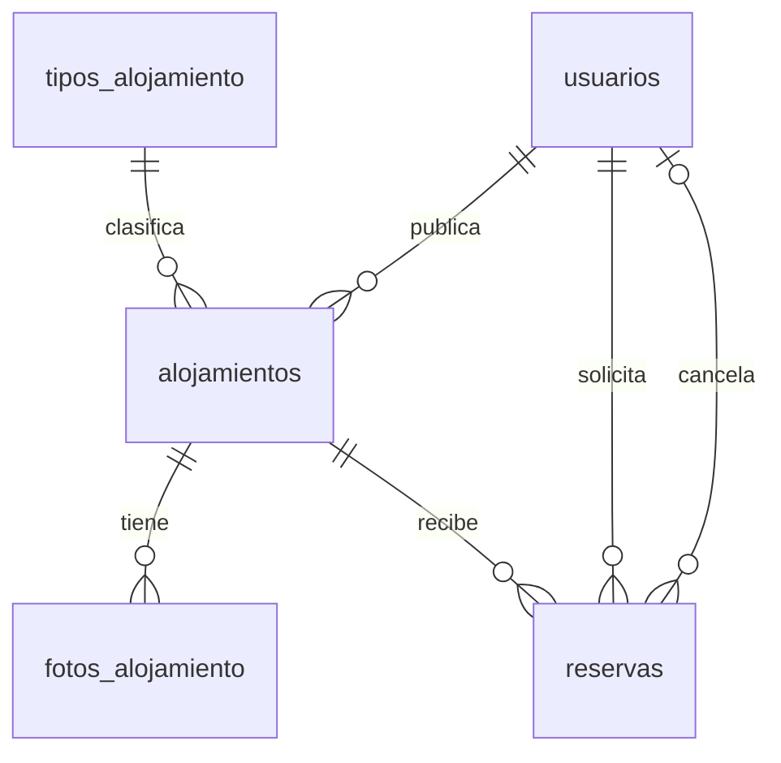
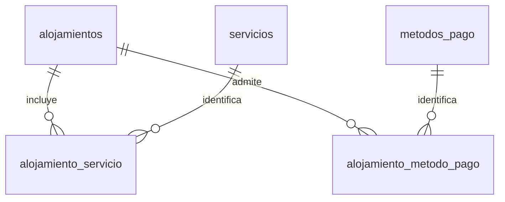

# Base de datos de alojamientos — PPI, versión 1

Material inicial para cuatro integrantes. No incluye la aplicación PHP ni modifica el hosting.

## 1. Decisiones incorporadas

- MariaDB 10.4 o posterior como destino inicial, tablas InnoDB y texto utf8mb4.
- Una cuenta puede publicar y solicitar reservas; anfitrión no es un rol exclusivo.
- El rol administrador se asigna fuera del registro público. El formulario nunca decide ese rol.
- Casas, apartamentos y habitaciones; no locales ni alquileres mensuales.
- Una publicación representa una unidad completa.
- Moneda de esta versión: dólares estadounidenses (USD).
- Tarifa por persona y por noche, conforme a la propuesta entregada.
- Total = noches × huéspedes × tarifa por persona/noche.
- Hasta ocho fotos por alojamiento. Las posiciones únicas de 1 a 8 limitan la cantidad; la de menor posición será la portada.
- Dirección, departamento, municipio y coordenadas obligatorias.
- Hora de entrada común: 15:00, zona America/El_Salvador. Esta es la referencia del plazo de cancelación; no se admiten horas distintas por alojamiento en v1.
- Salida exclusiva para el cálculo de noches: una salida el día 15 permite otra entrada ese mismo día.
- Pendientes no bloquean; aceptadas bloquean sus noches.
- Ambas partes pueden cancelar una reserva aceptada antes de la entrada. El solicitante debe hacerlo al menos 24 horas antes, inclusive; el anfitrión puede hacerlo hasta antes de la entrada.
- Las pendientes pueden retirarse antes de la entrada. Un rechazo del anfitrión se registra como rechazada.
- Reembolsos fuera del sistema: si el anfitrión cancela y recibió dinero, debe devolverlo directamente. La aplicación no cobra, ejecuta ni verifica devoluciones. Si cancela el solicitante, no se define aquí una política económica: la regla de 24 horas solo regula la cancelación en la aplicación.
- Desactivar una publicación conserva solicitudes e historial, la retira del catálogo/mapa e impide nuevas solicitudes. Propuesta operativa: tampoco aceptar pendientes mientras esté desactivada; las ya aceptadas se conservan y pueden cancelarse según las reglas.
- No transferir la propiedad de una publicación ni editar fechas/huéspedes de una reserva enviada en v1; cancelar y crear otra solicitud cuando proceda.

## 2. Modelo y relaciones

PK significa clave primaria: identifica cada registro. FK significa clave foránea: enlaza un registro con otra tabla. Por ejemplo, id_anfitrion apunta al usuario que publicó el alojamiento.



La relación de cancelación es opcional: una reserva sin cancelar no tiene cancelador.



| Tabla | Responsabilidad | Campos destacados |
|---|---|---|
| usuarios | Cuenta y acceso | correo único, password_hash, rol, estado |
| tipos_alojamiento | Catálogo de tipos | nombre único |
| alojamientos | Publicación | anfitrión, tipo, ubicación, capacidad, tarifa, estado |
| fotos_alojamiento | Rutas de imágenes | alojamiento, ruta, posición 1–8 |
| servicios | Catálogo de servicios | nombre único |
| alojamiento_servicio | Selecciones de servicios | clave compuesta; evita repetir un servicio |
| metodos_pago | Opciones informativas | nombre único |
| alojamiento_metodo_pago | Métodos de cada publicación | clave compuesta; evita repetir un método |
| reservas | Solicitud e historial | solicitante, fechas, huéspedes, tarifa aplicada, total, estado y cancelación |

La definición completa de campos y tipos está en 001_estructura.sql. Una FK evita referencias inexistentes, pero no decide permisos de usuario. Los índices ayudan a las consultas, sin garantizar por sí solos el objetivo de dos segundos.

### Estados de publicación

- borrador: todavía no aparece en el catálogo.
- publicado: admite nuevas solicitudes si el anfitrión está activo.
- inactivo: el anfitrión lo retiró temporalmente.
- bloqueado: moderación administrativa; el propietario no puede volver a publicarlo mientras siga bloqueado.

La publicación usa borrador para permitir guardar los datos antes de cargar fotos. PHP debe exigir al menos una foto al publicarla. La restricción de ocho fotos sí está representada en la base.

## 3. Instalar en XAMPP, paso a paso

1. Iniciar Apache y MySQL desde XAMPP.
2. Abrir http://localhost/phpmyadmin.
3. Ejecutar `SELECT VERSION();` y verificar el gestor y versión.
4. Crear una base nueva llamada `ppi_alojamientos`, con cotejamiento `utf8mb4_unicode_ci`.
5. Seleccionar esa base en el panel izquierdo.
6. Abrir Importar, elegir 001_estructura.sql y ejecutar.
7. Importar 002_catalogos.sql después.
8. Confirmar que aparecen nueve tablas, tres tipos, ocho servicios y dos métodos.

Comprobación:

```sql
SHOW TABLES;
SELECT * FROM tipos_alojamiento;
SELECT * FROM servicios;
SELECT * FROM metodos_pago;
SHOW CREATE TABLE fotos_alojamiento;
```

No ejecutar la estructura en la base de otro proyecto. No repetir los archivos como método de actualización: si ya hay tablas o catálogos, se esperan errores de duplicación. No desactivar CHECK ni las claves foráneas. Una importación de estructura que falle puede dejar tablas creadas; revisar antes de reintentar. No hay DROP TABLE ni instrucciones para borrar datos.

Los scripts no crean cuentas de usuario de la aplicación. El registro futuro generará hashes con `password_hash()` y comprobará acceso con `password_verify()`. No inventar un hash ni guardar contraseñas en texto para probar.

## 4. Reglas que deberá implementar PHP

El SQL es la estructura, no toda la lógica de la plataforma. Pendientes de programar:

- Validar sesión, cuenta activa, permisos y protección CSRF en operaciones de modificación.
- Registrar siempre rol usuario desde el servidor; no confiar en el rol enviado desde un formulario.
- Permitir editar solo publicaciones propias y moderar solo a administradores.
- Impedir solicitudes sobre alojamientos propios, no publicados o de usuarios inactivos.
- Impedir fechas de entrada pasadas y solicitudes después de la hora de entrada.
- Comprobar huéspedes contra la capacidad actual tanto al solicitar como al aceptar.
- Obtener la tarifa desde la base, calcular con precisión decimal y guardar tarifa/total en la solicitud. No confiar en precios ni totales enviados por JavaScript.
- Al aceptar, mantener la tarifa aplicada originalmente aunque el anuncio haya cambiado de precio.
- No permitir disminuir capacidad por debajo de huéspedes de reservas aceptadas futuras o en curso.
- Mostrar solo publicados de anfitriones activos en catálogo y mapa; para fechas seleccionadas, excluir los que tengan reservas aceptadas superpuestas.
- Validar archivos, tipos, tamaño, nombres y rutas de imágenes. Guardar archivos en el servidor y rutas relativas en la base.
- Validar cancelaciones con el reloj del servidor y America/El_Salvador; registrar el usuario autenticado que cancela, fecha y motivo. Guardar marcas temporales DATETIME en UTC; convertir para mostrar y para las reglas de entrada.
- Permitir transiciones: pendiente → aceptada/rechazada/cancelada; aceptada → cancelada. Rechazada y cancelada son finales. No aceptar ni rechazar pendientes cuya entrada ya pasó.
- Comprobar disponibilidad dentro de una transacción al aceptar, como se explica abajo.

### Aceptación sin reservas superpuestas

Los CHECK no comparan reservas distintas. La aplicación debe aplicar un protocolo común a todas las rutas que aceptan reservas:

1. Identificar el alojamiento de la reserva; ese vínculo no se modifica después de crearla.
2. Iniciar transacción en una única conexión.
3. Leer y bloquear primero la fila del alojamiento con SELECT ... FOR UPDATE.
4. Leer y bloquear después la solicitud; verificar que sigue pendiente, pertenece al alojamiento y que quien responde es su anfitrión activo.
5. Verificar publicación, fechas y capacidad actuales.
6. Buscar reservas aceptadas que se crucen, con lectura FOR UPDATE, usando:

```sql
SELECT id_reserva
FROM reservas
WHERE id_alojamiento = ?
  AND estado = 'aceptada'
  AND fecha_entrada < ?  -- salida de la nueva solicitud
  AND fecha_salida > ?   -- entrada de la nueva solicitud
FOR UPDATE;
```

7. Si hay cruce, hacer ROLLBACK e informar que ya no hay disponibilidad. La solicitud puede conservarse pendiente para que el anfitrión la rechace explícitamente.
8. Si no hay cruce, actualizar el estado a aceptada y respondido_en; hacer COMMIT.
9. Ante error o bloqueo fallido, ROLLBACK. No mostrar éxito antes del COMMIT.

El bloqueo de la fila del alojamiento serializa las aceptaciones aunque todavía no exista ninguna reserva. Usar siempre el mismo orden: alojamiento y después reserva. Cancelaciones y cambios de capacidad/estado también deben seguir ese orden y volver a validar la situación dentro de la transacción. No basta con consultar disponibilidad y luego actualizar fuera de ella.

La base permite consultas directas con SQL que eviten estas reglas; no hacer cambios manuales de estado en una instalación en uso. Más adelante se puede centralizar la operación en un procedimiento, si el hosting lo permite.

## 5. Organización entre cuatro integrantes

| Integrante | Módulo | Tablas principales |
|---|---|---|
| 1 | Cuentas, sesiones, perfil, permisos y listado administrativo de usuarios | usuarios |
| 2 | Publicaciones, fotos, servicios, métodos y moderación de publicaciones | alojamientos, fotos y catálogos asociados |
| 3 | Catálogo, filtros, detalle y mapa | consultas de alojamientos y disponibilidad |
| 4 | Solicitudes, aceptación, rechazo y cancelación | reservas, con lectura/bloqueo de alojamientos |

Los cuatro acuerdan nombres, respuestas de PHP y navegación. Elegir un responsable rotativo para integración y despliegue. Revisar conjuntamente la lógica de reservas y permisos.

GitHub guarda código y SQL; no sincroniza filas automáticamente. Cada integrante tendrá su copia local. El hosting tendrá una base de integración y, si el plan lo permite, otra para entrega. No se necesita acceso remoto directo desde XAMPP para probar una página PHP subida al hosting.

### Primer arranque del equipo

1. Crear el repositorio y agregar a los cuatro colaboradores.
2. Copiar estos SQL a una carpeta database y esta guía a docs.
3. Cada uno clona el repositorio e importa ambos SQL en su base local nueva.
4. Cada uno configura sus credenciales locales, fuera del repositorio.
5. Crear una rama por funcionalidad; revisar mediante pull requests antes de unir a main.
6. Subir al hosting la versión acordada; una sola persona aplica cambios de estructura allí.

### Cambios posteriores de estructura

No editar 001_estructura.sql como único modo de actualizar a compañeros que ya lo importaron. Agregar archivos ordenados: database/migrations/003_descripcion.sql, 004_descripcion.sql, etc. Coordinar números al revisar pull requests. Mantener un registro de migraciones aplicadas por entorno y ejecutar cada una una sola vez. No modificar una migración ya aplicada.

Cada cambio se entrega con su SQL y código compatible. Antes de aplicarlo al hosting: copia de seguridad, ensayo en una copia de pruebas y revisión de compatibilidad. Los cambios DDL de MariaDB pueden confirmar implícitamente; no suponer que un ROLLBACK deshace una modificación de tablas.

### Configuración y fotos

- Versionar config/conexion.php y un archivo de configuración de ejemplo sin contraseñas.
- Excluir credenciales reales, respaldos con datos personales y fotografías subidas por usuarios mediante .gitignore. Si un secreto ya fue subido, cambiarlo; .gitignore no borra el historial.
- Si la configuración queda dentro de la raíz web, usar un archivo PHP que no imprima sus datos. Preferir secretos fuera de la raíz pública cuando el hosting lo permita.
- Usar rutas relativas de imágenes. Las fotos de prueba compartidas deben acompañar los registros ficticios; compartir solo rutas no comparte los archivos.

## 6. Preparación del hosting

Falta conocer el proveedor/panel y verificar: soporte PHP, gestor/versión SQL, número de bases, directorio raíz del subdominio, límites de archivos y acceso remoto si lo desean. No asumir que una cuenta FTP incluye acceso al panel.

Crear la base desde el panel (el hosting puede exigir un prefijo), asignarle un usuario limitado a esa base, seleccionarla en phpMyAdmin e importar los dos SQL. Los scripts no contienen un nombre fijo de base. Configurar PHP con los datos que indique el proveedor: localhost solo cuando corresponda. Los permisos de modificación de estructura pueden separarse de los de la aplicación.

Esta entrega apunta a MariaDB 10.4+. Si el hosting ofrece MySQL u otra versión, verificar y adaptar antes de usar: no asumir equivalencia completa. CHECK debe estar soportado y activado para aplicar límites como las ocho fotos.

## 7. Comprobaciones de aceptación pendientes en su entorno

- Crear un alojamiento con ocho fotos; intentar posición 9 y posición repetida: ambas deben fallar en la base.
- Intentar correo repetido y referencias a usuarios inexistentes: deben fallar.
- Intentar salida anterior/igual a entrada, huéspedes cero, coordenadas fuera de rango o total incorrecto: deben fallar.
- Al desarrollar PHP: probar auto-reserva, exceso de capacidad y cambios de rol/permisos manipulados.
- Dos solicitudes pendientes cruzadas deben poder existir; al aceptarlas simultáneamente con dos sesiones, solo una debe quedar aceptada.
- Salida el día 15 y entrada de otra reserva el 15 no deben considerarse cruce.
- Cancelación del solicitante exactamente 24 horas antes: permitida; un segundo después: denegada para reservas aceptadas.
- Desactivar publicación: conservar reservas, retirarla del catálogo/mapa e impedir nuevas solicitudes.
- Probar búsquedas con 100 alojamientos y cuatro usuarios simultáneos en el hosting: objetivo de dos segundos para el listado, excluyendo carga completa de imágenes y mapa externo.

Validación de esta entrega: revisión de estructura, claves, restricciones y empaquetado. No ejecutada en un servidor MariaDB en este entorno; tampoco probada en su hosting. Los casos anteriores son la validación que deben realizar al importar y al implementar PHP, no resultados ya obtenidos.

## Referencias técnicas oficiales

- Restricciones MariaDB: https://mariadb.com/docs/server/reference/sql-statements/data-definition/constraint
- FOR UPDATE: https://mariadb.com/docs/server/reference/sql-statements/data-manipulation/selecting-data/for-update
- Importación/exportación phpMyAdmin: https://docs.phpmyadmin.net/en/latest/import_export.html
- Acceso remoto cPanel, cuando aplique: https://docs.cpanel.net/cpanel/databases/remote-database-access/
